<div align="center">

<picture>
  <source media="(prefers-color-scheme: dark)" srcset="./assets/header-dark.svg">
  
</picture>

<p>
  <a href="https://www.linkedin.com/in/rony-gabriel-oliveira-873993187/"></a>
  <a href="https://wa.me/5512997429538"></a>
  
</p>

</div>

## Sobre

Técnico de suporte com experiência prática em **NOC corporativo**: hoje atuo na **WEG, via Positivo S+**, fazendo triagem e diagnóstico de chamados no **ServiceNow**, monitorando switches core e roteadores **Cisco** e escalonando incidentes para as equipes de redes, servidores, cloud e para o Blue Team de segurança. **Splunk**, **FortiMail** e **Trellix Web Gateway** fazem parte da rotina.

Técnico em Informática, estudante de **Engenharia de Software** (UFBRA) e de **cibersegurança** (Santander Open Academy). Fora do expediente, escrevo ferramentas em C# e Python para entender o que acontece por baixo do sistema, principalmente forense no Windows e automação.

> **Busco vaga de** NOC · Suporte N1/N2 · Help Desk · Infraestrutura · SOC N1, no **Rio de Janeiro** ou **remota**.

## Experiência

**Técnico de Suporte Jr (NOC)** · Positivo S+, alocado na WEG · out/2026 – atual

- Triagem, diagnóstico e tratamento de **20 a 30 chamados por dia** no ServiceNow
- Escalonamento de incidentes para as equipes N2 de redes, servidores e cloud e para o Blue Team
- Monitoramento de switches core e roteadores Cisco e acompanhamento de incidentes de conectividade em filiais no Brasil e no exterior, junto aos técnicos locais
- Liberação de endereços MAC em switches e acesso remoto a equipamentos de rede via PuTTY
- Análise de eventos e e-mails com Splunk e FortiMail; categorização de sites no Trellix Web Gateway
- Reinício de serviços em Windows Server e rondas presenciais no data center

**Administrador de Servidor / Suporte Técnico** · Comunidade FluxoRP (~500 usuários) · 2019

- Atendimento de tickets: triagem, resolução e escalonamento
- Administração do servidor e investigação de denúncias de uso de hacks entre jogadores

## Competências

| Área | O que uso |
| --- | --- |
| **Redes e infraestrutura** | TCP/IP, IPv4/IPv6, DNS, switches, roteadores e APs Cisco, liberação de MAC, noções de configuração de switch (portas, trunk, shut/no shut), Wireshark (introdutório) |
| **Segurança e monitoramento** | Splunk, FortiMail, Trellix Web Gateway, MITRE ATT&CK |
| **ITSM e acesso remoto** | ServiceNow, SSH/PuTTY, ping, ipconfig |
| **Sistemas operacionais** | Windows 10/11 (instalação, configuração, troubleshooting), Windows Server, Kali Linux em VMware (noções) |
| **Programação** | Python e Lua (scripts e automações), C# (básico), PowerShell, Git |
| **Atendimento** | Troubleshooting, triagem, categorização, atendimento a usuários e escalonamento de incidentes |

## Projetos

<a href="https://github.com/Devzinh/GhostTrace">
  <picture>
    <source media="(prefers-color-scheme: dark)" srcset="./assets/card-ghosttrace-dark.svg">
    
  </picture>
</a>

**GhostTrace** é meu projeto de estudo em segurança defensiva: analisa tarefas agendadas, serviços e chaves de inicialização do Windows para apontar possíveis indícios de **persistência** ([MITRE ATT&CK T1053.005](https://attack.mitre.org/techniques/T1053/005/)). É o tipo de verificação que um analista faz ao investigar uma máquina suspeita.

<a href="https://github.com/Devzinh/sessionbridge">
  <picture>
    <source media="(prefers-color-scheme: dark)" srcset="./assets/card-sessionbridge-dark.svg">
    
  </picture>
</a>
<a href="https://github.com/Devzinh/pert-calculator">
  <picture>
    <source media="(prefers-color-scheme: dark)" srcset="./assets/card-pert-dark.svg">
    
  </picture>
</a>

Também mantenho **automações em Python** que cuidam de rotinas internas e geram relatórios de uma loja online própria.

## Formação

- **Engenharia de Software** · UFBRA · 2026 – 2030 (cursando)
- **Cibersegurança do Zero à Prática** · Santander Open Academy · 2026 (em andamento)
- **Técnico em Informática** · Microcamp · 2017 – 2019

**Idiomas:** português nativo · inglês intermediário

<details>
<summary><strong>Esta semana no editor</strong></summary>

<!--START_SECTION:waka-->

```txt
From: 24 October 2026 - To: 31 October 2026

No activity tracked
```

<!--END_SECTION:waka-->

</details>

<details>
<summary><strong>Repositórios de estudo</strong></summary>

- **[Exercícios C#](https://github.com/Devzinh/Exercicios-CSharp)**: lógica, orientação a objetos, algoritmos e consumo de APIs.
- **[Estudos na DIO](https://github.com/Devzinh/Dio.me)**: códigos de cursos, bootcamps e projetos da plataforma.

</details>

<br>

<picture>
  <source media="(prefers-color-scheme: dark)" srcset="./assets/footer-dark.svg">
  
</picture>

<div align="center">
<sub>Tem uma vaga de NOC, suporte ou infraestrutura? Fala comigo no <a href="https://www.linkedin.com/in/rony-gabriel-oliveira-873993187/">LinkedIn</a> ou no <a href="https://wa.me/5512997429538">WhatsApp</a>.</sub>
</div>
