<div align="center">

<picture>
  <source media="(prefers-color-scheme: dark)" srcset="./assets/header-dark.svg">
  
</picture>

<p>
  <a href="https://www.linkedin.com/in/rony-gabriel-oliveira-873993187/"></a>
  <a href="https://wa.me/5512997429538"></a>
  <a href="https://github.com/Devzinh?tab=repositories"></a>
</p>

</div>

## Sobre

Gosto de abrir a caixa-preta: entender o que um sistema faz por baixo e escrever a ferramenta que eu queria ter quando comecei a investigar.

Hoje isso significa **forense no Windows**, **automação de navegador com IA** e **utilitários de terminal**. Escrevo em Python e C#/.NET, e o que mais tenho praticado é validar entrada, tratar erro direito e testar antes de chamar de pronto.

Uso IA como ferramenta de implementação. A arquitetura, as decisões técnicas e a revisão do que vai para o repositório ficam comigo.

## Projetos

<a href="https://github.com/Devzinh/GhostTrace">
  <picture>
    <source media="(prefers-color-scheme: dark)" srcset="./assets/card-ghosttrace-dark.svg">
    
  </picture>
</a>

<a href="https://github.com/Devzinh/sessionbridge">
  <picture>
    <source media="(prefers-color-scheme: dark)" srcset="./assets/card-sessionbridge-dark.svg">
    
  </picture>
</a>
<a href="https://github.com/Devzinh/pert-calculator">
  <picture>
    <source media="(prefers-color-scheme: dark)" srcset="./assets/card-pert-dark.svg">
    
  </picture>
</a>

## Stack

<p>
  
  
  
  
  
  
  
</p>

<details>
<summary><strong>Esta semana no editor</strong></summary>

<!--START_SECTION:waka-->

```txt
From: 14 October 2026 - To: 21 October 2026

No activity tracked
```

<!--END_SECTION:waka-->

</details>

<details>
<summary><strong>Repositórios de estudo</strong></summary>

- **[Exercícios C#](https://github.com/Devzinh/Exercicios-CSharp)**: lógica, orientação a objetos, algoritmos e consumo de APIs.
- **[Estudos na DIO](https://github.com/Devzinh/Dio.me)**: códigos de cursos, bootcamps e projetos da plataforma.

</details>

<br>

<picture>
  <source media="(prefers-color-scheme: dark)" srcset="./assets/footer-dark.svg">
  
</picture>

<div align="center">
<sub>Tem uma ideia, uma dúvida sobre os projetos ou uma vaga? Fala comigo no <a href="https://www.linkedin.com/in/rony-gabriel-oliveira-873993187/">LinkedIn</a> ou no <a href="https://wa.me/5512997429538">WhatsApp</a>.</sub>
</div>
